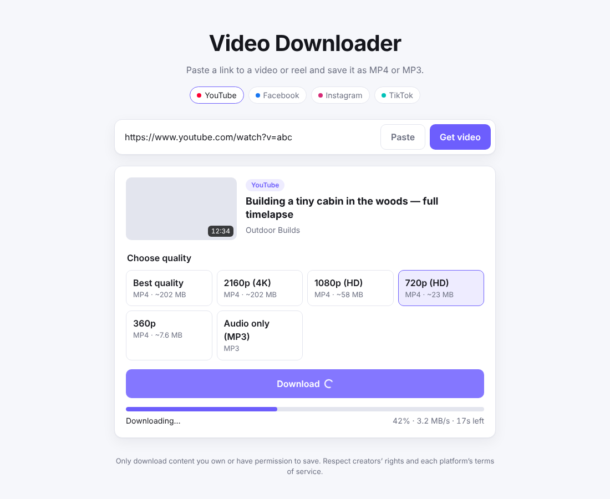

# Video Downloader

A small web app that downloads videos and reels from **YouTube, Facebook, Instagram and TikTok**.
Paste a link, pick a quality (Best, 1080p, 720p, … or MP3 audio), and the file is downloaded to
your device.



- **Backend:** Python + [FastAPI](https://fastapi.tiangolo.com/), with
  [yt-dlp](https://github.com/yt-dlp/yt-dlp) for extraction and ffmpeg for merging and converting
- **Frontend:** plain HTML, CSS and JS that the backend serves at `/`, so no build step is needed

> Only download content you own or have permission to save, and respect each platform's terms of
> service and creators' copyrights.

## How it works

1. `POST /api/info` checks that the link points to a supported platform. It then asks yt-dlp for
   the title, thumbnail, duration and available resolutions.
2. `POST /api/download` starts a background job. yt-dlp downloads the best streams for the chosen
   quality, and ffmpeg merges them into an MP4 or converts them to an MP3.
3. The page polls `GET /api/jobs/{id}` to show progress, speed and ETA. When the job finishes,
   the browser downloads the file from `GET /api/jobs/{id}/file`.
4. Finished files are deleted after `FILE_TTL_MINUTES`.

Only `youtube.com`/`youtu.be`, `facebook.com`/`fb.watch`, `instagram.com` and `tiktok.com` links
(including their subdomains) are accepted. This stops the server from being used to fetch
arbitrary URLs.

## Run locally

Requirements: Python 3.10+ and `ffmpeg` on your PATH.

```bash
cd video-downloader
python -m venv .venv && source .venv/bin/activate
pip install -r requirements.txt
uvicorn app.main:app --reload --port 8000
```

Open http://localhost:8000.

## Run with Docker

```bash
cd video-downloader
docker build -t video-downloader .
docker run -p 8000:8000 video-downloader
```

## Deploy

The app needs ffmpeg, so it **can't run on Netlify** (unlike the React app at the repo root).

### Vercel

The app runs on Vercel's **Container** runtime, which builds `video-downloader/Dockerfile`:

- Framework preset: **Container**
- Root directory: `video-downloader`
- Suggested env vars: `MAX_FILESIZE_MB=500`, `MAX_DURATION_MINUTES=60`,
  `MAX_CONCURRENT_DOWNLOADS=2`

On Vercel the app switches to **stateless mode** by itself, because it detects `VERCEL=1`.
Requests can land on different instances there, so each download is a single request
(`GET /api/stream`). That request downloads the video on the server and returns the file
directly. The page shows a timer while the server works, then a progress bar while the file
transfers.

**YouTube on Vercel:** YouTube often blocks cloud-hosting IPs and replies "Sign in to confirm
you're not a bot". To work around this:

1. Export cookies from a browser where you're logged in to YouTube, in Netscape `cookies.txt`
   format. A throwaway account is best.
2. Paste the file's contents into a `YTDLP_COOKIES` env var.
3. Redeploy.

TikTok, Instagram and Facebook links work without cookies.

### Docker hosts (Render, Railway, Fly.io, a VPS)

Point the host at `video-downloader/Dockerfile`. It picks up the `PORT` env var. Here downloads
run as background jobs and the page shows live server-side progress.

Run **one** worker process, because download jobs are tracked in memory. To handle more load,
raise `MAX_CONCURRENT_DOWNLOADS`.

## Configuration (env vars)

| Variable | Default | Purpose |
|---|---|---|
| `MAX_CONCURRENT_DOWNLOADS` | `3` | Downloads that run in parallel |
| `MAX_PENDING_JOBS` | `20` | Queued and running jobs before the server returns "busy" |
| `MAX_FILESIZE_MB` | `2048` | Largest file the server will download |
| `MAX_DURATION_MINUTES` | `180` | Longest video allowed (`0` = no limit) |
| `FILE_TTL_MINUTES` | `30` | How long a finished file stays available |
| `DOWNLOAD_DIR` | system temp dir | Where files are stored temporarily |
| `COOKIES_FILE` | – | Path to a Netscape `cookies.txt`, for content that needs a login (some Instagram and Facebook posts, and YouTube on cloud hosts) |
| `YTDLP_COOKIES` | – | The *contents* of a `cookies.txt`. Use this on hosts like Vercel where you can't add files |
| `STATELESS` | auto | `1` forces single-request stream mode. It turns on automatically on Vercel |
| `YTDLP_PROXY` | – | Outbound proxy for yt-dlp |

## Keeping it working

Platforms change often, and yt-dlp releases fixes quickly. If downloads from one site start
failing, update yt-dlp first:

```bash
pip install -U "yt-dlp[default,deno,curl-cffi]"
```

YouTube needs a JavaScript runtime for full format support. The `deno` extra installs one
automatically.

Some Instagram and Facebook content is only visible to logged-in users. Export cookies from a
browser session, save them to a file, and set `COOKIES_FILE` to its path. Treat that file like a
password.

## Tests

```bash
pip install -r requirements-dev.txt
pytest
```

The end-to-end tests run the real yt-dlp and ffmpeg pipeline against a local test video.
